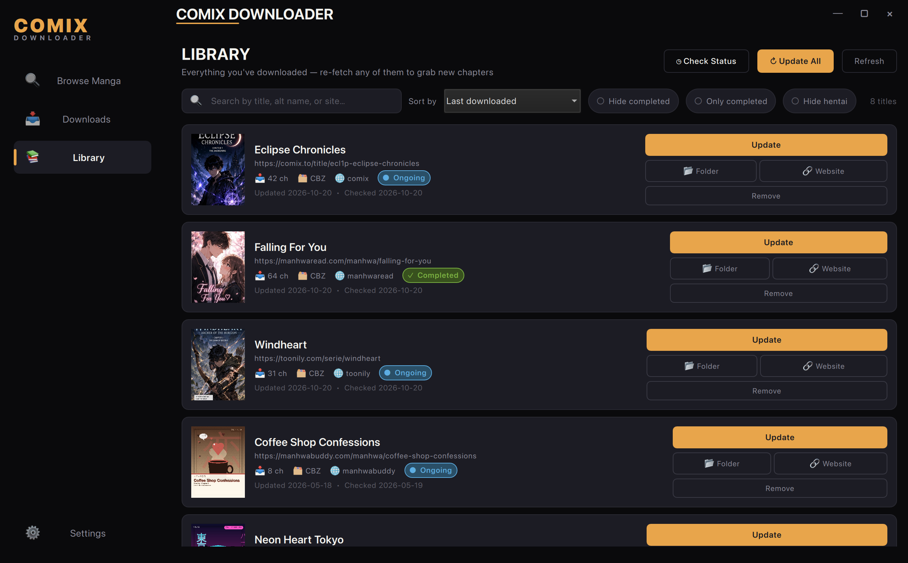

<div align="center">

# 🎨 Comix Downloader

[](https://python.org)
[](LICENSE)
[]()

**A multi-site manga / manhwa / doujinshi downloader with GUI & CLI**

*Fast concurrent downloads • Multiple formats • Persistent library • Multi-job UI • Pluggable providers*



</div>

> **Fork notice.** This is a fork of [Yui007/comix-downloader](https://github.com/Yui007/comix-downloader)
> with substantial additions — see [What's new in this fork](#-whats-new-in-this-fork).
> Original copyright held by [Yui007](https://github.com/Yui007); fork additions
> © hybridia. Both contributions released under the MIT License.

---

## 🌐 Supported sites

| Site | Auth | Notes |
|------|------|-------|
| `comix.to` | none | `/api/v1` SPA — Playwright DOM-scrape fallback (site rotates anti-scraper keys daily) |
| `nhentai.to` | none | inline `_gallery` JSON parser |
| `hitomi.la` | none | per-deploy `gg.js` URL maths |
| `hentaifc.com` | none | obfuscated charcode-array reader decode |
| `hentairead.com` | none | preview-thumb → full-image host swap |
| `hentaifox.com` | none | hidden form fields + `g_th` JSON |
| `toonily.com` | Cloudflare only | multi-chapter manhwa via curl_cffi |
| `manhwaread.com` | none | mangomic theme + base64 chapterData |
| `global.toomics.com` | **paid login** | email+password (or cookie paste) → `secrets.json` |
| `mangafire.to` | anti-bot only | Playwright captures CF cookies + VRF token |

---

## ✨ Features

| Feature | Description |
|---------|-------------|
| 🖥️ **Modern GUI** | PyQt6/QML dark-theme UI |
| 🎨 **Beautiful CLI** | Rich terminal interface with progress bars |
| ⚡ **Concurrent downloads** | Multi-threaded chapters AND images per chapter |
| 📁 **Multiple formats** | Export as **Images**, **PDF**, or **CBZ** (with ComicInfo.xml) |
| 🎯 **Smart selection** | Single chapter, range (`1-10`), or all |
| 🎨 **Scanlator filter** | Filter and prefer specific scanlation groups |
| 📚 **Persistent library** | `library.json` tracks every download; one-click "Update" diffs against the source |
| 🪟 **Multi-job UI** | Download several mangas at once — each gets its own card with cover, progress, and active chapter rows |
| 🔁 **Resume / skip** | Whole-chapter skip when artifact exists; per-image resume mid-chapter |
| 📝 **Per-run failure log** | Failed chapters listed in `<download>/<title>/_failed.txt` for easy retry |
| ⚙️ **Persistent settings** | Saved to `config.json` |

---

## 🆕 What's new in this fork

- **9 additional providers** beyond the original three (`comix.to`, `nhentai.to`, `hitomi.la`):
  `hentaifc.com`, `hentairead.com`, `hentaifox.com`, `toonily.com`, `manhwaread.com`,
  `global.toomics.com` (paid), `mangafire.to`.
- **Comix.to anti-scraper resilience.** comix.to rebuilt as an SPA on `/api/v1`
  with VMProtect-style obfuscated request signing AND encrypted response bodies.
  Direct HTTP signing (port of [HaruNeko](https://github.com/manga-download/haruneko)'s
  `ComixTo.ts` connector) is the fast path; falls back transparently to a
  Playwright service that drives a real Chromium and scrapes the rendered
  DOM when the algorithm rotates (which it does often).
- **Mangafire Playwright pipeline.** Dedicated worker thread owning Chromium
  to capture both the Cloudflare clearance cookies and per-path VRF tokens.
- **Toomics paid-account support.** Email/password login flow stored in
  gitignored `secrets.json` (mode 0600); cookie-paste fallback for when
  toomics adds captchas to the form.
- **Persistent library** (`library.json`). Library tab shows every
  downloaded series; "Update" diffs against the source provider and
  queues new chapters automatically.
- **Multi-job download UI.** Start two or three downloads at once; each
  gets its own card on the Downloads tab with cover, title, per-job
  overall progress, and active chapter rows. Finished cards stick around
  until you click *Clear Finished*.
- **Per-run failure log** at `<download>/<title>/_failed.txt`. Re-running
  the same selection naturally retries only failures (the resume logic
  whooshes past completed chapters).
- **Curl_cffi + adaptive per-host rate limiter** in `SessionManager` —
  chrome120 TLS impersonation, 4 req/s/host start, halve on 429/403,
  recover on 25-success streaks.
- **Single-config-file fix.** Previous behaviour wrote to `gui/config.json`
  vs `config.json` depending on launch directory; both front-ends now
  resolve the same project-root file.
- **Library-wide resume + skip.** Whole-chapter skip when the artifact
  is already on disk; per-image resume mid-chapter for the IMAGES /
  `keep_images=true` path.
- **Diagnostic scripts** in `scripts/` (one per anti-bot provider) so
  when a site changes you can quickly see which pipeline stage broke.

---

## 🚀 Installation

### Prerequisites
- Python 3.10 or higher
- pip

### Quick start

```bash
git clone https://github.com/<YOUR_USER>/comix-downloader.git
cd comix-downloader

pip install -r requirements.txt
```

### Optional but recommended for some providers

**Mangafire and current-generation comix.to need a real browser.** Install
Playwright + Chromium (~150 MB into the venv):

```bash
pip install playwright
python -m playwright install chromium
```

Without Playwright:
- `mangafire.to` only works if you manually paste a fresh `cf_clearance`
  cookie into `secrets.json["mangafire"].cookie`.
- `comix.to` chapter listing / page fetching will fail whenever the site
  rotates its signing keys (frequently).

### Cloudflare bypass (built-in)

The downloader uses **[curl_cffi](https://github.com/lexiforest/curl_cffi)**
to impersonate Chrome's TLS / HTTP-2 fingerprint in-process — defeats most
Cloudflare fingerprint blocks **without any extra service**. Already in
`requirements.txt`.

Per-host adaptive rate limiting is enabled out of the box: starts at 4
req/s/host, halves on `429`/`403`, recovers gradually. **You should not
need a VPN for normal use.**

#### When you still need FlareSolverr

Only required if a site throws a hard JS challenge that curl_cffi can't
pass. To enable as a safety net:

1. Download the latest [FlareSolverr release](https://github.com/FlareSolverr/FlareSolverr/releases).
2. Run it.
3. The downloader auto-detects it at `http://localhost:8191/v1` and
   only invokes it when curl_cffi gets blocked.

---

## 📖 Usage

### GUI mode (recommended)

```bash
python gui/main.py            # GPU rendering (default)
python gui/main.py --cpu      # software rendering for compatibility
```

1. Paste a URL from any [supported site](#-supported-sites).
2. Click **FETCH** to load info and chapters.
3. Select chapters; choose a scanlator preference for multi-group series.
4. Click **DOWNLOAD CHAPTERS**. Switch to the Downloads tab to monitor.
5. Open the **📚 Library** tab to see everything you've downloaded; the
   per-card **Update** button checks for new chapters at the source.
6. Open **⚙️ Settings** for output format, paths, workers, and toomics
   login.

### CLI mode

```bash
# Interactive (URL + chapter prompts)
python main.py

# Direct
python main.py download "https://comix.to/title/<hid>-<slug>" -c "1-10" -f cbz
python main.py download "https://nhentai.to/g/648201/" -f cbz
python main.py download "https://hitomi.la/manga/example-english-3914539.html" -f pdf
```

### Toomics (paid account)

1. Open the GUI → **⚙️ Settings → TOOMICS LOGIN**.
2. Enter email + password → click **🔐 Login**.
3. Click **Test** to verify (green message = ready).
4. Toomics rotates session cookies daily — re-run **Login** when listings
   stop loading. Credentials stay stored, so it's one click.

Credentials are stored in `secrets.json` at the project root (gitignored,
mode 0600). Cookie-paste fallback is also exposed in the same panel.

### Mangafire / current comix.to (Playwright pre-flight)

The first time either provider runs in a session you'll see a
`[vrf-worker]` or `[comix-worker]` line in the terminal as Chromium boots.
Subsequent calls reuse the same browser. Set `MANGAFIRE_HEADLESS=0`
(mangafire) or `COMIX_HEADLESS=0` (comix) to see the browser if you're
debugging an anti-bot block.

### Diagnostic scripts

When a site changes under us, run the matching script — it prints what
each pipeline stage saw, so the broken stage is obvious:

```bash
python scripts/comix_test.py [<comix.to URL>]
python scripts/mangafire_test.py [<mangafire URL>]
python scripts/toomics_test.py [<toomics URL or numeric id>]
```

---

## ⚙️ Settings reference

| Setting | Description | Default |
|---------|-------------|---------|
| `output_format` | `images` / `pdf` / `cbz` | `images` |
| `keep_images` | Keep raw images after PDF/CBZ build | `false` |
| `enable_logs` | Verbose stderr logging | `false` |
| `download_path` | Where artifacts land | `downloads` |
| `max_chapter_workers` | Concurrent chapter downloads | `3` |
| `max_image_workers` | Concurrent images per chapter | `5` |
| `use_curl_cffi` | TLS-impersonation HTTP client | `true` |
| `impersonate` | curl_cffi target | `chrome120` |
| `requests_per_second_per_host` | Rate limit start | `4.0` |
| `min_requests_per_second` | Rate limit floor | `0.5` |
| `max_requests_per_second` | Rate limit ceiling | `8.0` |
| `flaresolverr_url` | Optional fallback service URL | unset |
| `verify_ssl` | Verify TLS certs (set `false` only if local CA store is broken) | `true` |

---

## 📁 Project structure

```
comix-downloader/
├── main.py                       CLI entry point
├── config.json                   User settings (project-root anchored)
├── secrets.json                  Per-provider auth (gitignored, mode 0600)
├── library.json                  Persistent download library (gitignored)
├── gui/
│   ├── main.py                   GUI entry point
│   ├── bridge/                   Python ↔ QML bridges (download, library, manga, settings)
│   └── qml/                      Views + components (multi-job ProgressPanel, LibraryView, …)
├── scripts/                      Per-provider diagnostic scripts
└── src/
    ├── api/comix.py              comix.to low-level API + Playwright fallback router
    ├── providers/                Per-site providers (uniform Provider ABC)
    ├── core/                     Models, downloader, failure log
    ├── formats/                  images / cbz / pdf
    ├── cli/                      Typer + Rich CLI
    └── utils/                    config, secrets, library, session, hash, comix_capture, mangafire_vrf, …
```

For the deep architectural notes, conventions, gotchas, and a per-feature
changelog, see [CLAUDE.md](CLAUDE.md).

---

## 🔧 Dependencies

**Core:**
- [Requests](https://requests.readthedocs.io/), [Pillow](https://pillow.readthedocs.io/),
  [ReportLab](https://www.reportlab.com/), [BeautifulSoup4](https://www.crummy.com/software/BeautifulSoup/),
  [curl_cffi](https://github.com/lexiforest/curl_cffi)

**GUI:** [PyQt6](https://pypi.org/project/PyQt6/)

**CLI:** [Typer](https://typer.tiangolo.com/), [Rich](https://rich.readthedocs.io/)

**Optional (mangafire + comix.to fallback):** [Playwright](https://playwright.dev/python/) + Chromium

---

## 🙏 Acknowledgements

- **[Yui007](https://github.com/Yui007)** — original
  [comix-downloader](https://github.com/Yui007/comix-downloader): the
  comix.to RC4 signing port, project skeleton, GUI shell, and original
  three providers.
- **[manga-download/haruneko](https://github.com/manga-download/haruneko)**
  — `ComixTo.ts` connector that the comix.to hash port in
  `src/utils/hash.py` is derived from.
- **[zzyil/AIO-Webtoon-Downloader](https://github.com/zzyil/AIO-Webtoon-Downloader)**
  — inspiration for the Playwright-based VRF capture pattern that
  `src/utils/mangafire_vrf.py` (and now `src/utils/comix_capture.py`) is
  built on.

---

## 📜 License

MIT — see [LICENSE](LICENSE).

---

## ⚠️ Disclaimer

For personal use only. Respect the copyright of manga authors and
publishers; support official releases when available.

---

<div align="center">

Original by [Yui007](https://github.com/Yui007) • Fork additions by hybridia

⭐ Star if useful!

</div>
